# فسحة

موقع عربي يساعدك على مراجعة أثر الاستمرار في جلسة اخترتها على التزامات يومك. يقارن بداية التخطيط الحالية ببداية مؤخرة، ويعرض جدولًا صالحًا أو خيارات لتعديل القيود. لا يراقب التطبيقات الأخرى، ولا يشخّص الإدمان، ولا يثبت إنجاز الالتزامات الحقيقية.

واجهة RTL فاتحة بلوني الكحلي والأخضر، وخطوط زمنية SVG، ونوافذ تعديل، ومؤقت اختياري، وسجل قرارات محلي. جميع بيانات البداية **مؤلفة لأغراض العرض**.

## المشكلة والتقييم والاستدامة المقترحة

يصف دليل الجائزة (ص15) استخدامًا رقميًا يؤثر في الأداء اليومي. قد لا يرى المستخدم أثر دقائق إضافية على التزام له نافذة محددة. يقارن مشروع فسحة خطة البدء الآن بخطة مؤخرة، وفق مدد يقدرها المستخدم، ويميز التعذر السابق من أثر التأخير. لا يشخص الإدمان ولا يراقب التطبيقات الأخرى؛ المنفعة السلوكية فرضية تحتاج اختبارًا.

المستهدف: نسبة قرارات الاستمرار التي تغيرت بعد التفسير من جميع قرارات الاستمرار، ونسبة الالتزامات المنجزة بإقرار المستخدم، ووقت إدخال الخطة وتعديلها بالدقائق. تجربة لاحقة تقارن بمنبه أو تقويم بسيط لدى بالغين موافقين. إمكان الخطة نتيجة حسابية، وإتمامها إفادة ذاتية؛ لا تجربة بشرية أو أثر إدمان مقاس.

استدامة مقترحة: تشغيل محلي دون API إلزامي، وصيانة بمستودع موثق واختبارات. يُدرس التوسع والتكامل الاختياري بعد تجربة منفعة طوعية. النشر العام يحتاج استضافة وحماية وصيانة مستمرة؛ لا شراكة أو تمويل سابق.

الواجهة عربية RTL وفُحص عرض 390 بكسل. دعم لوحة المفاتيح وقارئ الشاشة يحتاج تقييمًا إضافيًا؛ لا ادعاء توافق معياري.

## التشغيل

يلزم Node.js **22 أو أحدث**. لا توجد حزم تشغيل أو حاجة إلى `npm install` أو مفتاح API.

```sh
npm start
# http://127.0.0.1:4310
npm test
npm run build
npm run verify
```

`verify` يعيد تشغيل الاختبارات ويولد `docs/evidence.json` و`docs/verification-output.txt`، ثم يبني نسخة مستقلة. `build` يفحص صياغة جميع وحدات الإنتاج ويخرج ثمانية ملفات تشغيل إلى `dist` مع manifest. لتشغيل النسخة المبنية:

```sh
node dist/server.mjs
```

المنفذ الافتراضي 4310؛ يمكن تغييره بمتغير `PORT`. الخادم مرتبط بـ `127.0.0.1` ويقبل GET وHEAD فقط للمسارات المعلنة. التطبيق لا يحتوي حسابات أو أدوار أو واجهة خادمية لبيانات المستخدم؛ البيانات في متصفح المستخدم فقط. لا تنشره على شبكة عامة دون إعادة تصميم نموذج النشر وحماية الوصول المناسبة.

## مشاهد العرض

1. افتح «نظرة اليوم»: عينة من ثلاثة التزامات وحدث ثابت. المقارنة الافتراضية ١٥ دقيقة تعرض جدولين ممكنين وهامشيهما.
2. اختر ٣٠ دقيقة: يصبح جدول البداية المؤخرة متعذرًا، بينما الخطة الحالية ممكنة. يوضح الموقع أن تعذر القيود مجتمعة لا يثبت فشل التزام بعينه حتمًا.
3. طبّق خيار تأجيل «مراجعة درس»: تُزال من خطة اليوم وتُحسب خطة الالتزامات المتبقية. يمكن إعادة إضافتها بنافذة جديدة.
4. في «التزاماتي»، حمّل العينة ثم عدّل مدة مراجعة الدرس إلى ٩٥ دقيقة. تظهر عبارة «الخطة متعذرة أصلًا» حتى قبل التأخير.
5. أضف التزامًا وعدّل نافذته ثم احذفه. أضف حدثًا ثابتًا متداخلًا للتحقق من رسالة الرفض العربية.
6. اختر التوقف أو الاستمرار. راجع «قراراتي وبياناتي»، وأعد فتح الصفحة للتأكد من حفظ السجل. صدّر نسخة JSON أو امسح بيانات فسحة.
7. شغّل المؤقت الاختياري: يعرض وقت التفاعل والوقت المنقضي كلًا على حدة. إخفاء التبويب أو دقيقة خمول يوقف عد التفاعل، ثم يُستأنف مع نشاط جديد. لا يمتد هذا القياس إلى مواقع أخرى.
8. افتح «الدليل التقني» لقراءة الدليل الفعلي وحدود النموذج.

## العقد الحسابي

| عنصر | الحد أو الافتراض |
|---|---|
| التخطيط | شخص واحد ويوم واحد، دقائق صحيحة من 0 إلى 1440 |
| الالتزامات | من 1 إلى 8؛ معرّف فريد، اسم، مدة موجبة، وقت إتاحة، موعد نهائي |
| الأحداث الثابتة | حتى 32 فترة غير متداخلة؛ التلامس عند الحدود مسموح |
| التنفيذ | الالتزام غير قابل للتجزئة، ولا يوجد تداخل بين التزامات الشخص |
| التأخير | عدد صحيح غير سالب لا يتجاوز نهاية اليوم من بداية التخطيط |
| الانتقال | لا زمن انتقال محسوب إلا إذا أُدخل في المدد أو كحدث ثابت |
| المدد | تقديرات المستخدم، والإنجاز الفعلي `unknown` |
| ترتيب الحل | شاهد ممكن، وليس ترتيبًا أمثل للأولوية أو الهامش |
| الاستعادة | أمثلة إزالة بأقل عدد من الالتزامات؛ حتى ستة أمثلة، وليست كل البدائل |

`solve(tasks, blocks, now)` يعيد `feasible` مع `schedule`، أو `infeasible` مع سبب وخيارات إزالة، أو `invalid` مع رسائل عربية. `compareDelay(tasks, blocks, now, delay)` يعيد `still-feasible` أو `lost-feasibility` أو `already-infeasible` أو `invalid`. لكل فترة صالحة: البداية لا تسبق الإتاحة أو بداية التخطيط، والنهاية لا تتجاوز الموعد، والمدة مساوية للمدخل، ولا تقاطع مع الأحداث الثابتة أو الالتزامات الأخرى.

البحث يجرب الترتيبات ويضع كل التزام في أقرب بداية متاحة. وضع الالتزام أبكر في ترتيب ثابت لا يقلل فرص الأعمال اللاحقة؛ الانتظار مسموح، والقيود ثابتة. عند الوصول إلى مجموعة الالتزامات نفسها، الوصول في وقت أسبق يهيمن على الوصول في وقت لاحق؛ لهذا تُحذف الفروع اللاحقة. حد الثمانية يعني 40320 ترتيبًا كاملًا كحد تعداد، وتُختبر مجموعات إزالة من ضمن 255 مجموعة كحد أقصى. تفاصيل البرهان والحدود في [المعمارية](docs/architecture.md).

## الاختبارات والدليل

الدليل المعروض يُولد من تشغيل Node الفعلي، ولا يُولّد من نتائج اجتماعية متخيلة. راجع [الدليل JSON](docs/evidence.json)، [المخرجات الكاملة](docs/verification-output.txt)، [البناء](docs/build-output.txt)، [تقرير التنفيذ](docs/implementation-report.md). سجلات RED الأصلية محفوظة في `red-output.txt` و`red-server-output.txt` و`red-build-output.txt`.

الاختبارات تشمل ترتيبًا يفشل فيه greedy رغم وجود حل، فحص فترات جدول قبل التأخير، تعذرًا سابقًا، مقارنة 200 خطة صغيرة بمرجع مستقل يجرب **كل أوقات البدء الصحيحة** بدل نسخ بحث المحرك، مدخلات غير صالحة وحد اليوم، 8 التزامات وخيارات إزالة، مؤقت التبويب المخفي والخامل، التخزين والمسح المحدد، أمن المسارات والمضيف والأصل وطرق HTTP، وبناء نسخة التشغيل.

## مقارنة منضبطة

| بديل | ما تصفه مصادره الرسمية | تركيز نموذج فسحة |
|---|---|---|
| [Motion](https://www.usemotion.com/help/time-management/auto-scheduling/reference-auto-scheduling/what-auto-scheduling-considers) | جدولة تلقائية تراعي مدة المهام والمواعيد وغيرها | مقارنة قرار تأخير محدد بخطة البداية الحالية |
| [RescueTime](https://help.rescuetime.com/article/162-how-to-automate-a-focus-session) | أتمتة بدء جلسات التركيز | تفسير أثر التأخير على نوافذ التزامات صرّح بها المستخدم |

المصادر الرسمية العامة روجعت في ٨ أكتوبر ٢٠٢٦؛ لم نختبر منتجات المنافسين. عدم ظهور ميزة في صفحة عامة لا يثبت غيابها. لا ندعي اختراع الجدولة أو جدة عالمية أو إثبات علاج الإدمان الرقمي. تقييم الفائدة السلوكية يحتاج لاحقًا تجربة بشرية بموافقة المشاركين، مع قياس الفهم وصحة التقديرات والقرارات؛ **لا توجد نتائج ميدانية الآن**.

## الخصوصية والحقوق

المفتاح المحلي الوحيد `fusha.v1`، وسجل القرارات محدود بآخر 100 قرار. تصدير JSON تحت تحكم المستخدم. المسح يزيل هذا المفتاح فقط؛ العينة الجديدة تبقى في الذاكرة دون حفظ حتى تعديل جديد أو قرار. المؤقت في الذاكرة وينتهي عند إعادة التحميل. إذا منع المتصفح التخزين، يعرض الموقع تنبيهًا ويدعم تصدير نسخة الذاكرة. البيانات على المتصفح لا تعني حمايتها من مستخدمي الجهاز الآخرين.

لا بيانات هوية أو مفاتيح حقيقية في المستودع، ولا Gemini أو تكامل API حي. الحقوق محفوظة؛ لم تُمنح رخصة مفتوحة تلقائيًا. يتطلب أي قرار تسجيل ملكية أو علامة تحققًا مستقلًا.

## مخططات قابلة للعرض

### المعمارية

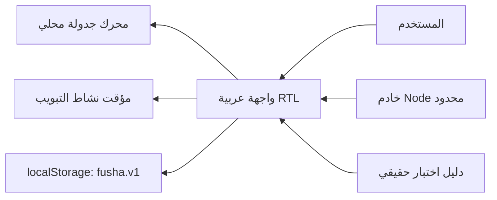

### رحلة المستخدم

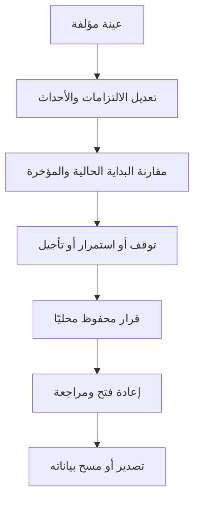

### مقارنة السببية الحسابية

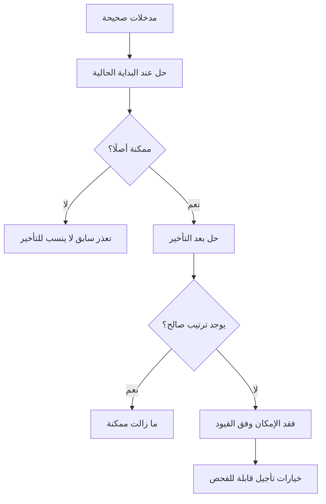

### حالات المؤقت

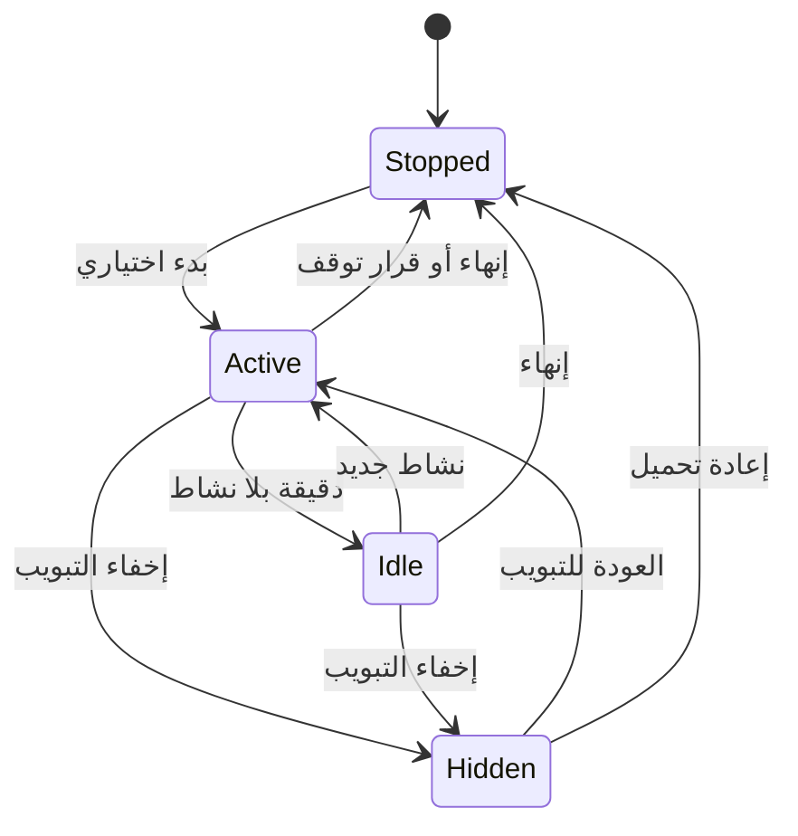

### البيانات

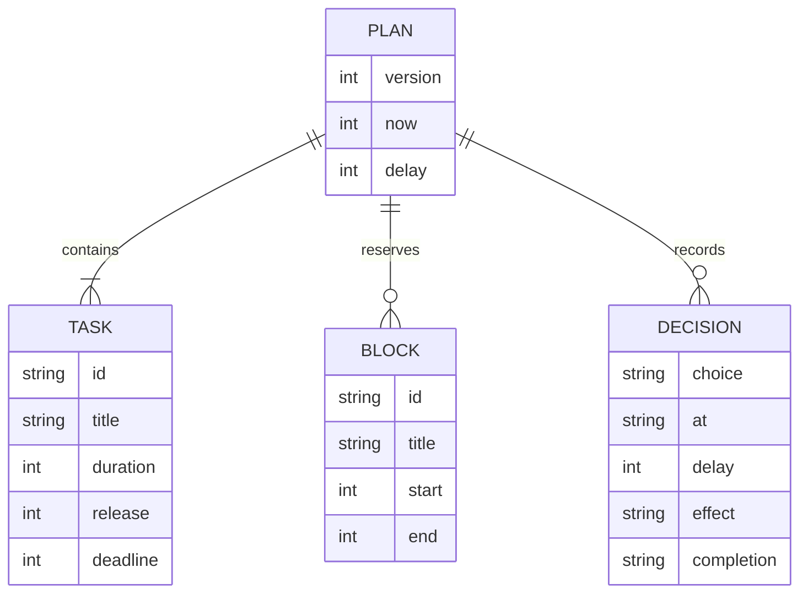

### مسار التحقق

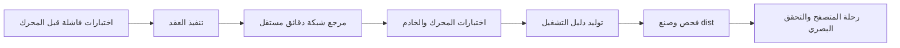

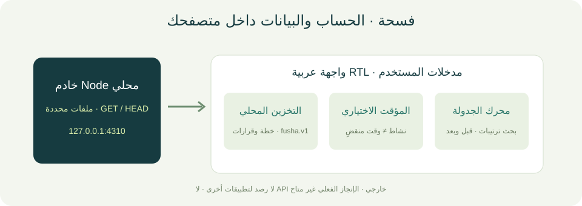
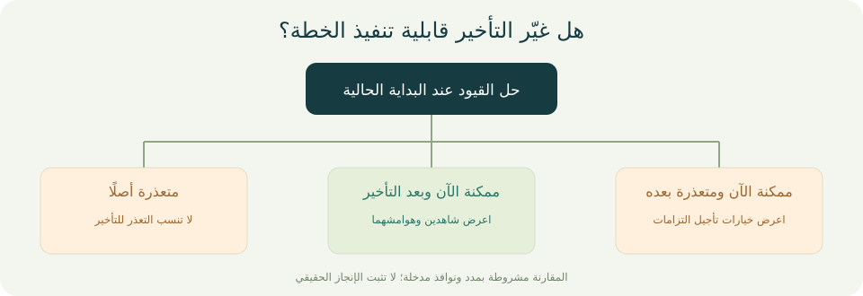
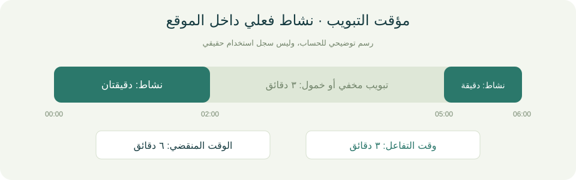

صور الواجهة الفعلية في القسم الأخير. المخططات أعلاه توضيحية ولا تُعرض بوصفها لقطات شاشة.

## صور النسخة المنفذة والتحقق النهائي

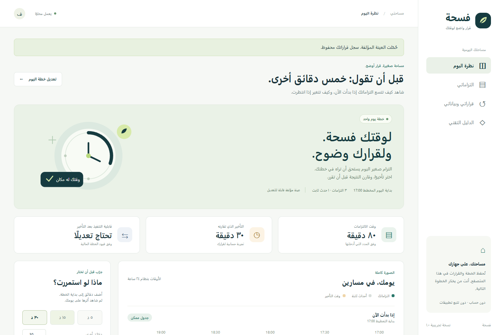

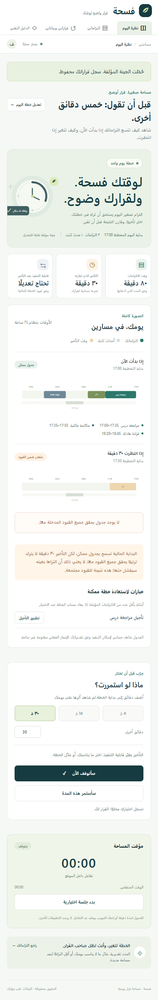

تحقق المنسق من 11 اختبارًا ناجحًا دون احتساب نسخ dist، ومن رحلة المتصفح والتصدير والعرض بعرض 390px دون أخطاء JavaScript أو تجاوز أفقي. الأدلة في `docs/coordinator-final-tests.txt` و`docs/coordinator-browser-qa.json`. حالات التجربة مؤلفة ولا تمثل أثرًا اجتماعيًا مقاسًا.

## مستودع GitHub

[مستودع فسحة](https://github.com/faisald2926/fusha)
